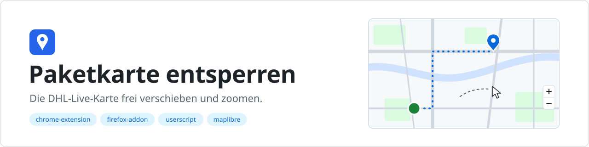
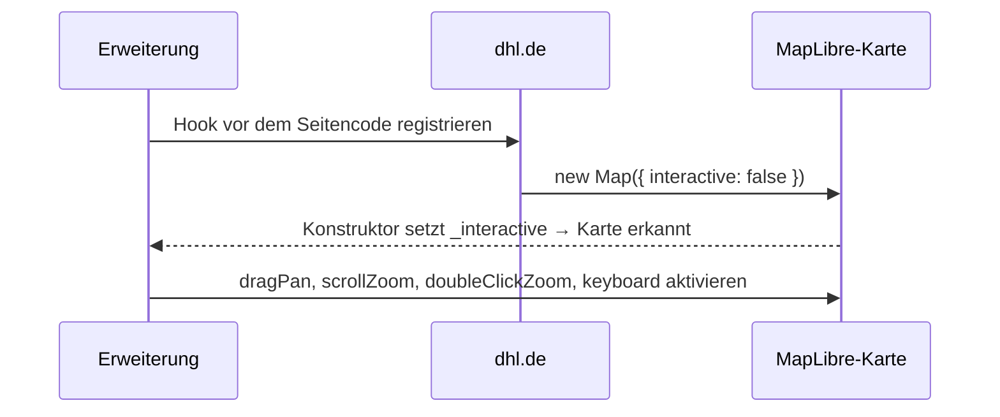

<div align="center">

<picture>
  <source media="(prefers-color-scheme: dark)" srcset="assets/banner-dark.svg">
  
</picture>

<br>

Browser-Erweiterung, die die Live-Zustellkarte der DHL-Sendungsverfolgung verschieb- und zoombar macht.

[](https://github.com/howlongcanthisevenbewowitsamazing/paketkarte-entsperren/actions/workflows/build.yml)
[](https://github.com/howlongcanthisevenbewowitsamazing/paketkarte-entsperren/releases/latest)
[](LICENSE)


[Installation](#installation) · [Funktionsweise](#funktionsweise) · [Entwicklung](#entwicklung) · [Problem melden](https://github.com/howlongcanthisevenbewowitsamazing/paketkarte-entsperren/issues/new/choose)

</div>

---

In der Live-Zustellung lässt sich die Karte nur über die +/− Buttons zoomen. Verschieben geht nicht, weil die Seite die Karte mit `interactive: false` erzeugt. Diese Erweiterung schaltet die normale Kartensteuerung wieder ein.

|                     | Ohne       | Mit         |
| ------------------- | :--------: | :---------: |
| Verschieben (Maus)  | –          | ✓           |
| Mausrad-Zoom        | –          | ✓           |
| Doppelklick-Zoom    | –          | ✓           |
| Tastatur (Pfeile)   | –          | ✓           |
| Zoomstufen          | 10–15      | 6–18        |

## Installation

| Browser | Weg |
| --- | --- |
| Chrome, Edge, Vivaldi, Brave | [Chrome Web Store](#) · oder ZIP aus den [Releases](https://github.com/howlongcanthisevenbewowitsamazing/paketkarte-entsperren/releases/latest) |
| Firefox (ab 128) | [addons.mozilla.org](#) |
| Jeder Browser mit Tampermonkey/Violentmonkey | [Userscript auf Greasy Fork](#) |

<details>
<summary>Manuell installieren (ohne Store)</summary>

**Chrome / Edge / Vivaldi / Brave**
1. `paketkarte-entsperren-chrome-*.zip` aus den [Releases](https://github.com/howlongcanthisevenbewowitsamazing/paketkarte-entsperren/releases/latest) laden und entpacken.
2. `chrome://extensions` öffnen, **Entwicklermodus** einschalten.
3. **Entpackte Erweiterung laden** → entpackten Ordner wählen.

**Firefox (temporär, zum Testen)**
1. `about:debugging#/runtime/this-firefox` öffnen.
2. **Temporäres Add-on laden** → `paketkarte-entsperren-firefox-*.zip` wählen.

**Userscript**
1. Tampermonkey oder Violentmonkey installieren. In Chromium-Browsern bei der Erweiterung unter *Details* „Userscripts zulassen“ aktivieren.
2. `paketkarte-entsperren.user.js` aus den Releases öffnen und installieren.

</details>

## Funktionsweise

Die Karte ist eine [MapLibre GL](https://maplibre.org/)-Instanz, die in einem gebündelten Modul erzeugt wird und von außen nicht erreichbar ist. Das Skript läuft deshalb vor dem Seitencode (`document_start`, `world: MAIN`) und erkennt neue Karten an einer Eigenschaft, die der MapLibre-Konstruktor setzt. Danach werden die Interaktions-Handler aktiviert.



Der gesamte Code steht in [`src/unlock.js`](src/unlock.js) (gut 40 Zeilen).

> [!NOTE]
> Ändert DHL die Seite oder die MapLibre-Version, kann die Erweiterung aufhören zu funktionieren. In dem Fall bitte ein [Issue](https://github.com/howlongcanthisevenbewowitsamazing/paketkarte-entsperren/issues/new/choose) anlegen.

## Datenschutz

- Läuft ausschließlich auf `https://www.dhl.de/*`
- Keine Berechtigungen, keine Netzwerkanfragen, kein Speicher
- Liest, speichert und überträgt keine Daten

## Entwicklung

```
src/
  unlock.js              Gemeinsamer Code für alle Varianten
  userscript-header.js   Metadaten-Block für das Userscript
manifests/
  chrome.json            Manifest für Chromium-Browser
  firefox.json           Manifest für Firefox (inkl. Gecko-ID)
icons/                   16, 48, 128 px
build.ps1                Baut alles nach dist/
```

Bauen (Windows PowerShell 5.1 oder PowerShell 7):

```powershell
./build.ps1
```

Ergebnis in `dist/`:

```
paketkarte-entsperren-chrome-<version>.zip
paketkarte-entsperren-firefox-<version>.zip
paketkarte-entsperren.user.js
```

### Release

1. `version` in `manifests/chrome.json` **und** `manifests/firefox.json` erhöhen.
2. Committen und einen Tag pushen:
   ```sh
   git tag v1.0.1
   git push origin v1.0.1
   ```
3. GitHub Actions baut alle Dateien und hängt sie an das Release.

## Hinweis

Privates Open-Source-Projekt. Keine Verbindung zu DHL, Deutsche Post oder der DHL Group. Alle Marken gehören ihren jeweiligen Inhabern.

## Lizenz

[MIT](LICENSE)
